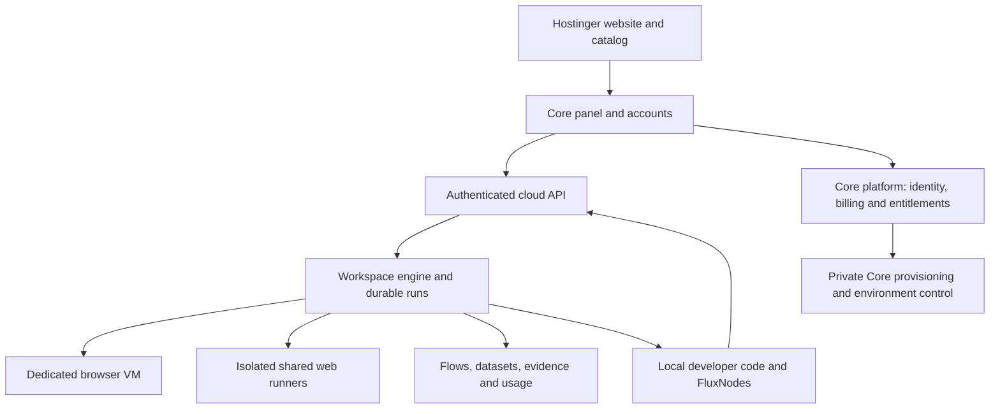

# Hosted Platform Launch Audit And Plan

Status: Paused
Status detail: Paused as a separate workstream during the approved data-first execution week; unresolved work and historical evidence are retained below.
Created: 2026-11-14
Last updated: 2026-11-23
Owner: Senior supervisor agent
Scope: Hosted panel, coordinated releases, managed web cloud, local FluxNodes, marketplace and self-hosting.
Paired document: ../!FluxIQ/docs/working/hosted-platform-launch-plan.md
Related: [Hosted production](./hosted-production-plan.md), [MVP seal](./mvp-seal-plan.md)

## Current State

**User direction, 2026-11-23:** "for now we'll only focus this week on getting the core product 100% working". This plan stays paused until the core product is proven (the data-first plan's recorded-run proofs and supervised paid round). The web viewer below is to be recorded here, not built this week.

**Cloud browsers since the 2026-11-17 snapshot (lead, from dev history 2026-11-23):**
- Merged into dev 11-18 and 11-19:
  - t943: a dedicated browser enrols only into its own tenant.
  - t948: checkout plans by quantity; admission counts dedicated browsers.
  - t953: hosted dedicated browsers on local Docker. This covers the panel's environments API (create, list, start, stop and change), a Docker environment driver, the `deploy/runner/Dockerfile` runner image, and the browser host's runner mode, which takes its enrolment ticket on stdin and serves one browser for its own workspace only.
- The earlier managed browser host (t907, 11-12) is proven locally on Chromium.
- All of this runs only in local Docker. No real VM fleet, no shared compute, no deployment.
- So the 11-17 "not built" items "environment controller", "tenant-bound enrolment" and "Linux runner image" now exist in local form. "A remote viewer" still has no code: a 2026-11-23 search for noVNC, websockify, x11vnc, screencast and viewer code in Core `apps/web`, `packages/fluxiq` and downstream `browser-host`/`deploy` found none.

**HC-V. Web remote viewer and takeover (planned unit; user asked 2026-11-23 for "a way for user to see whats goin on via vnc type viewer", "web based ofc").** Lead's design, recommended to the user on 2026-11-23:
- **Display.** The runner container draws its headed Chromium on a virtual display (Xvfb), with a VNC server attached to that display only. The panel shows it through noVNC in an ordinary page; the user installs nothing. A full display is chosen over Chrome's page screencast because a person taking over needs the browser chrome, the extension's side panel, native dialogs and file pickers, which a page-only screencast cannot show.
- **Access.** The VNC socket is never published. Core proxies it as a WebSocket behind the signed-in panel session. Only the environment's owning tenant can open it, under an IAM action of its own (for example `environments:View` and `environments:TakeControl`). Each view and takeover is written to the audit log.
- **Modes.** Watch-only by default. "Take control" grants input, and automation on that environment waits: the running Flow parks as a person-needed ask, never a failure. Handing back resumes it from where it waited, with the person's changes treated as the new page state. Lasting acts already done are never repeated.
- **Use.** The same viewer serves the takeover requests that login, MFA and person checks raise (Phase 3), and the run page links to the live view of the environment running it.
- **Acceptance.** Tenant A can never open tenant B's view. A revoked session closes an open view. Watch-only sends no input. A takeover parks and resumes one realistic task with its Flow intact. No VNC port is reachable from outside the container network. It works in Chrome and Firefox panels.
- **Owners.** Downstream `deploy/runner` (display, VNC) and `browser-host` runner mode. Core panel route, proxy, IAM action and viewer page (paired Core plan).
- **Schedule.** After the core product is proven. Slots into Phase 3 (VM runner and remote viewer on staging, 12-04 in the critical path above).

**Priority reconciliation, 2026-11-22:** [Data-first simplification](./data-first-simplification-plan.md) is the current implementation plan of record (approved S7). This pauses this separate plan, does not mark its remaining work complete, and does not cancel another running session. The earlier snapshot below is historical; its code and acceptance were not revalidated by this documentation change. Prior status detail: Hosted-cloud lane (2026-11-17): t914 reconciled, dated schedule to launch 2026-12-10, units HC1-HC5a starting; nothing deployed.

Last updated 2026-11-17 (hosted-cloud lane). Go-live target **2026-12-10**. Nothing is deployed; hosted
deployments are simulated on this machine until the user approves a VM, DNS or a payment provider.

**Landed on `dev`:** all of t914's commits (both repositories): accounts and provisioning, sessions,
per-account workspaces, IAM on every route, SDK keys and proof sessions, the commerce ledger (eligibility
only), email transport (not sent live), the app registry, `deploy/` (schema-valid only). The usable-client
plan removed the unlock (a connected client has model access) and made the panel and extension usable.

**Not built:** payments and the entitlement state machine; an environment controller and tenant-bound
enrolment for a dedicated browser per customer; a Linux runner image; a remote viewer; hosted sign-in in the
extension; a production home for sign-up; account export, backup and restore proof, monitoring; the store
listing and legal texts. Tenant-isolation closure is in progress (HC2).

**t914's uncommitted work:** kept only for content startup inertness, a `fluxiq.revoked` message and the
sign-in tab registry additions (HC1). The per-verb admission refactor is dropped in favour of t926's tab gate.
The privacy and capture-authority modules are parked on the t914 branch.

**Schedule (critical path):** usable local client 11-21 -> hosted panel with accounts on one server,
simulated locally, 11-27 -> tenant-bound browser enrolment 12-01 -> VM runner and remote viewer on staging
12-04 -> dedicated browser per customer and billing in test mode 12-08 -> go/no-go 12-09 -> launch 12-10.
This needs the user's answers on the VM, Linux tooling, payment provider and legal entity, and the sign-up
home by 11-20. Otherwise 12-10 launches invite-only with free or test-mode billing. The store listing is off
the critical path (submit about 12-02). After launch: marketplace, shared compute, OS environments, enterprise
licensing.

**Next:** HC1 content inertness, HC2a workspace-scope routing, HC3 the cloud platform package
(`@fluxiq/cloud`, `fluxiq-cloud up|down|status|smoke`, one config file; local Docker rehearsal of the real
server, only config values differing), HC4 billing engine (Stripe, tested on stripe-mock), HC5a environments
design and record; all five dispatched 2026-11-17 (tasks t934, t936-t939). The user's decisions (2026-11-17):
all cloud testing local in Docker for now, it WILL run on a real server with a domain, payments through Stripe,
the company is FluxIQ, port 4000 is never used (NoMachine). **Sign-up:** hosted sign-up is Core's own page at
`app.getfluxiq.com/signup`, with the website linking to it; Core's provisioning, welcome, per-account workspaces
and IAM exist, while the page, live email, tenant isolation (HC2) and the extension's hosted sign-in remain.
**Enterprise sign-in (planned after HC2, same sign-in code):** a self-hosted company panel has no public sign-up;
the first owner claims it with a setup code and admins invite employees (exists today). The unit adds OIDC
single sign-on (Okta, Entra, Google Workspace) through Core's existing identity-provider port, membership on
first sign-in limited to the company's domain, IdP groups mapped to roles, and the fix for invited people
showing as enabled before they accept; directory-driven removal (SCIM) and licensing follow launch.
**Pricing and billing roles (user, 2026-11-18, "we'll likely tweak it later"):** hosted pricing per dedicated
browser plus seats for teams; self-hosted enterprise as an annual per-seat license delivered as a signed,
offline-verifiable license file; customers keep their own model keys (no resale of model usage at launch).
FluxIQ alone sets prices: Stripe products and prices, mapped to Core entitlements by the commerce config file the
cloud package writes, so a price change is configuration, not code (an operator admin page follows launch).
Enterprise admins never set FluxIQ prices; they get a billing-admin IAM role, seats, invoices and billing contact
(hosted), license status (self-hosted: seats used, expiry, renewal), spending limits on their company model key per
team or person, and usage reports by team for internal chargeback. Customers setting their own prices (reselling,
publishers selling Flows) is the post-launch marketplace on Stripe Connect, pending the user's decisions on fee,
refunds and tax. Launch needs checkout with one or two simple plans; seats, invoicing and the license file follow.
**Test every mode (user, 2026-11-18: "make sure to test everything. The self-hosted enterprise, the normal local
panel, and our hosted solution"):** each cloud unit's acceptance runs all three deployment modes locally: `service`
(our hosted platform) and `self-hosted` (free base now, enterprise once licensing exists) through `fluxiq-cloud up`,
`smoke` and `down`, and the normal local panel through `node scripts/run-fluxiq-web.mjs`. The license only adds
company extras (SSO, directory sync, seats, support); local and free self-hosted keep the full base product.
**Self-hosted enterprise design (lead's proposal, 2026-11-18, user told; builds after launch with enterprise SSO):**
one codebase, no separate edition: the operator's configuration selects the `self-hosted` profile, our cloud's
commerce, tenancy and fleet modules stay off there, our credentials never ship, and the server never calls our
billing system. Enterprise features are unlocked by a signed license file (FluxIQ holds the private key; Core
verifies issuer, organization and installation binding, features, seats and validity with the public key, offline;
backend and UI share one entitlement resolver; grace on expiry, base use and export kept). Both repositories are
public, so the protection is the license terms plus support and updates, not secrecy; enterprise-only features in a
private package remain an option for later. The buyer's journey: getfluxiq.com's Enterprise page (checkout or
invoice for annual seats) leads to an organization area on `app.getfluxiq.com` (download the license, seats,
expiry, renewal, install instructions); the company installs with the same `@fluxiq/cloud` package or our published
Docker image, one config (domain, ACME TLS, SMTP, license path), `fluxiq-cloud up`, claims the owner with the
one-time setup link, and invites employees or connects SSO; renewal swaps in a new license file, air-gapped
included. Built: the self-hosted profile, its compose, the setup-code claim, the cloud package's local driver. Not
built: license verification, the organization area, the website's Enterprise page and purchase, published image
and package, the cloud package's real-server driver. Units, interfaces I1-I4 and the dated schedule are in the hosted-cloud lane report, held locally until the tenant-isolation units merge (both repositories are public).

## Evidence And Readiness

Detailed source citations: [Core](./hosted-platform-launch-plan/reports/core-audit.md), [browser](./hosted-platform-launch-plan/reports/browser-audit.md), [website](./hosted-platform-launch-plan/reports/website-audit.md). Implemented means inspected source, not production acceptance.

| Area | Existing | Remaining |
| --- | --- | --- |
| Website | Static Next export served by Node; Hostinger build documented | Signup/catalog/checkout; live source provenance |
| Panel | Dockerfile, Compose profiles, Caddy, health checks, persistent mount | Actual Linux/TLS/email/restore proof; composed web-domain/browser product |
| Accounts | IAM, platform SQLite, private provisioning, sessions, tenant manager | Auth/program routes/gateway still use primary-instance paths; C2/C3 migration |
| Email | File/none senders | Production delivery and recovery |
| SDK | Remote URL, HTTP/SSE, local callback answers | P3b server/session and public mounting; current headless API is loopback/open-mode |
| Durability | Saved Flows/tasks/effects, same-process reconnect | Active run registry/events/callback waits are in memory; restart recovery |
| Browser | Chromium launcher, enrollment, profiles, leases/cleanup | Fleet, Linux image, remote viewer, OS-level customer isolation |
| Extension | Editable URLs, managed enrollment | Hosted server profiles/sign-in, data minimization/store copy |
| Billing | Generic billing/entitlement ports | Subscription, ledger, compute lifecycle/reconciliation |
| Marketplace | Flow/library building blocks | Publisher/catalog/package/install/version/entitlement/revocation lifecycle |
| Self-hosting | Profiles/deployment assets | Same-release install/upgrade/restore/export proof |

Supervisor independently inspected Core auth/program route, email resolver, SDK session/execute-run, server open-mode guard, downstream browser launch/named-profile and Website config/workflows/docs. Exact paths are in the reports. The old no-hosted-extension-code statement is stale: enrollment exists, consumer hosted sign-in does not. W5 improvements do not close C2/C3. Core's FluxNode plan already names cloud API/pools/metering under P12 and local/cloud parity. This plan expands that direction and replaces the old same-VM landing-site recommendation; existing runtime contracts remain authoritative. Do not resume t843.

## Hosting And Ownership

Hostinger's current [Node.js limits](https://www.hostinger.com/support/hostinger-node-js-limits-for-web-and-cloud-plans/) exclude inbound WebSockets, persistent workers, Docker and extra services, with a 120-second request limit. Keep it for the website, not Core's gateway/browser fleet. Its [Git guide](https://www.hostinger.com/support/how-to-deploy-a-nodejs-website-in-hostinger/) supports website auto-deployment. Capture hPanel settings before rollout: user calls the package Cloud Starter; docs say Cloud Startup.

Accepted topology: separate Core server. Recommend a persistent Linux VM on AWS plus separate customer workers; select region/size from measurements. AWS is a candidate, not a purchase or cheapest-price claim. Keep provider integration replaceable.

Return events use client-initiated streaming and answer POST, not inbound laptop access. Debugging/provisioning/storage stay private. Customer execution must not share the control plane's security boundary.

| Owner | Responsibilities |
| --- | --- |
| Core | Accounts/auth/IAM, tenancy, SDK, execution, host leases, data, panel, billing/subscriptions/metering/entitlements and provider adapters; generic environment/catalog/notification backends |
| Web-extension | Browser/domain, launcher/image, web takeover, consumer/store UX, browser acceptance |
| Website | Public marketing/catalog/pricing/publisher presentation, account links |
| FluxIQ Cloud deployment | Configures and operates Core modules and payment/mail/cloud integrations; brand/prices/provider credentials are deployment configuration, not a second backend |
| Product deploy/ | Pinned composition, release manifest, infrastructure definitions and operational runbooks; not the business-service implementation |
| Customer app | Local declarations/checks/transforms/business UI; optional hosted callback/app worker |

Core owns the substantial platform implementation in focused modules, not a catch-all service. Browser/DOM behavior stays downstream and loads through public contracts. Website is a presentation/client of Core APIs, not another identity/commerce backend. Port useful signup stand-in logic to its Core owner instead of maintaining two systems. No provisioning secret in Hostinger. Create paired Core/downstream records before implementation; this update changes the plan only.

### What Runs Where

| Location | Hosted responsibilities |
| --- | --- |
| getfluxiq.com on Hostinger | Independent Website repo: landing pages, pricing, public marketplace presentation, documentation links and app entry links; public Core API reads where needed |
| app.getfluxiq.com on separate managed compute | Core panel/API, accounts/auth/IAM, workspaces, billing/subscriptions, entitlements, usage, catalog backend, scheduling and fleet control |
| Private platform infrastructure | Core databases, queues, secret custody and object storage; not publicly served website assets |
| Managed worker servers | Dedicated/shared customer execution, browser runtime/extension, isolated profiles and explicitly hosted application workers; separate from control-plane trust boundary |
| Customer computers/servers | Same Core in local/self-hosted mode with optional local panel and own execution environments, or just application/client code calling FluxIQ Cloud |

Core code ownership does not require all modules to run in one process or machine. Separate API, scheduler, metering and fleet processes when needed while retaining Core ownership. Initial API uses app.getfluxiq.com; api.getfluxiq.com can be an alias later, not a separate backend. The website repo updates independently against a compatible Core API/release contract.

### Deployment Context And Later Enterprise Activation

Extend existing local/self-hosted/service profiles. Resolve context from explicit operator configuration and instance identity; discovery reports profile/capabilities for clients to display the correct setup and execution location. Loopback detection can suggest onboarding defaults. Hostname, IP, email suffix and client flags must never establish privilege, paid status or enterprise access. Enterprise entitlement is independent of location: it may apply locally, self-hosted or in cloud.

Local installs use their own identity/security configuration and can omit cloud-commerce providers. Self-hosted servers require appropriate authentication, without a FluxIQ Cloud subscription for base execution. Our service deployment enables Core commerce/tenant/fleet modules with our provider configuration. Our credentials are never shipped in customer builds; local runs do not need calls to our billing system.

Later enterprise work: explicitly link an installation to an authorized organization or import a signed license. Core verifies issuer/signature, feature grants, organization/installation binding, validity and activation authority; backend and UI share the entitlement resolver. Organization membership/login alone is not a paid-license proof. Design offline validation, renewal/revocation, grace, transfer and expiry in that future phase, including air-gapped use where contracted. Preserve base local functionality and export on expiry. Feature list, prices and exact license policy remain future decisions.

Cloud subscription grants and future enterprise license grants enter Core through distinct trusted entitlement sources; neither bypasses IAM or tenancy. Future acceptance covers spoofed context/domains, forged/expired licenses, cross-organization activation and legitimate offline operation. This is an architectural seam now, not an enterprise implementation request.

## Product Contracts

### Supported Operating Modes

| Mode | Application/client | Engine and execution | FluxIQ Cloud dependency |
| --- | --- | --- | --- |
| Fully local developer | Developer's code on laptop or own server | Their Core plus their browser/environment on their hardware | None for core execution; optional catalog/cloud services only by explicit use |
| Fully self-hosted network | Code on customer's devices/servers | Customer-operated authenticated Core and environment fleet | None for execution; customer manages network, identity, keys and infrastructure |
| Hybrid developer | Code, checks and transforms on customer's laptop/server | Authenticated FluxIQ Cloud engine and selected cloud environment | API access and paid cloud allocation; only necessary inputs/evidence/results cross boundary |
| Consumer client with local execution | Extension or another client | Local/self-hosted Core and user's connected environment | None for local operation |
| Consumer client with cloud execution | Extension or hosted panel | FluxIQ Cloud plus explicitly selected managed browser | Hosted identity/entitlement; no developer setup required |
| Cloud engine with personal browser | Extension enrolled by its user | Cloud Core controls that authorized personal browser | Hosted control services, but no managed-browser compute charge; availability requires connected browser |
| Fully managed application | Hosted app/worker or installed marketplace app | Cloud engine and managed environments | Hosting for app/callbacks and automation billed as distinct resources |

Fully local means independent of FluxIQ's website, billing service and cloud authentication availability. BYOK may still require the customer's external model provider during exploration; deterministic execution can run without that provider when the Flow needs no model. A customer can operate locally over their own network with their own authenticated endpoint. Loopback open-mode convenience must not become unauthenticated LAN/internet access.

SDK exposes endpoint/credential profiles and an explicit environment selection. Same declarations and schemas work across modes, subject to installed runtime capabilities and authorized resources. Never silently fall back from local to cloud (spend/data transfer), cloud to local (personal browser actions), dedicated to shared, or one region/account to another. Copying a Flow between deployments is explicit export/import; runtime-owned cookies, provider/access credentials and customer data do not travel implicitly. Exported artifacts carry compatibility metadata and preserve provenance without exposing secrets.

For consumers, onboarding asks where work runs: this browser, a managed cloud browser, or a chosen self-hosted server. The panel labels both connected server and execution target on every run. Selecting a cloud browser does not transfer the user's local cookies or logged-in sessions: offer an authenticated remote login/takeover flow. A lost personal browser connection becomes a recoverable wait, not a switch to someone else's/cloud profile. Changing target for a running task is a checked migration, not a UI setting flip.

### Journeys And Product Surfaces

| Journey | Complete path |
| --- | --- |
| Local developer | Install engine/web runtime; start own browser host; connect SDK to local endpoint; declare/run FluxNode; inspect local panel/results; back up/export independently |
| Hybrid developer | Create account/workspace; buy/select capacity; provision environment; register API key; copy endpoint/profile; run same code; inspect run/usage; rotate/revoke key |
| Consumer | Install extension or open app; sign in/connect chosen server; select personal/cloud environment; authorize sites/lasting actions at start; run; answer takeover requests; inspect result/cost |
| Marketplace user | Browse without login; inspect publisher/permissions/runtime/cost; sign in; choose workspace/environment; install version and bind secrets; run; approve upgrades; uninstall without silently deleting shared datasets |
| Dedicated owner | Purchase reservation; see provisioning progress; configure browser/login; run; inspect resources; resize/stop/restart; export/cancel/delete with explicit retained-storage costs |
| Publisher | Register identity; submit immutable artifact; validation/review; preview permissions; publish; maintain versions/respond to incidents; payouts only when that product is enabled |

Public navigation: Product, Cloud, Marketplace, Developers/docs, Pricing, Self-hosting and Sign in. App navigation: Overview, Runs, Environments, Flows/apps, Data, API/access, Usage/billing and Settings. Publisher workspace and operator console have explicit separate permissions. Screens use the same API actions/authorization as SDK callers; no privileged UI-only routes. CLI onboarding can open a browser login/enrollment flow, while unattended servers enroll a restricted service key through a human-authorized setup.

### Cloud Services And Durable Records

These are logical modules; the initial product can deploy them as a modular service plus worker processes rather than many microservices. Persist cross-module transitions before performing external effects. The control plane decides who may run and pay; a workspace engine owns execution; worker environments own the browser/OS resources.

| Module | Durable records and authority |
| --- | --- |
| Identity/access (Core) | Principals, memberships, roles/policies, API keys/sessions, revocation; resolves caller and tenant |
| Core account/commerce | Billing accounts, provider customer/subscription references, versioned plans/prices, entitlements and usage allowances |
| Environment controller | Environment ID, owner, region, runtime/image version, capacity class, provider resource IDs, desired/observed state, persistent volume/profile references |
| Admission/router | Durable accepted submission, idempotency identity/digest, payer/entitlement snapshot, reservations, authorized placement and queue ticket |
| Scheduler/lease owner | Workspace-to-engine route, fenced run/environment leases, queue priorities, fairness and recovery assignments |
| Workspace engine (Core) | Runs, callbacks/events/checkpoints, Flow versions, effects, datasets/lineage and person-needed state |
| Meter/reconciler | Append-only usage events, allocation intervals, invoice aggregates, adjustments and provider reconciliation |
| Catalog/install service | Publisher identity, signed package versions, review state, tenant installations, permission grants and upgrade history |
| Notifications/integrations | Transactional mail, takeover/run notifications, signed webhook deliveries and dead-letter/retry state |
| Operator tooling | Fleet health, incidents, redacted diagnostics, support access grants, provisioning/billing reconciliation and audited manual actions |

An account can own multiple workspaces; workspace/project scoping controls data and execution. Billing account is the payer, not an IAM principal. Each environment has an owner workspace and a billing allocation; sharing across workspaces requires explicit grants and payer acceptance. A run snapshots actor/client, workspace/project, environment or placement request, payer, entitlement revision, price version and artifact version. A paid account cannot gain another tenant's data by choosing their identifiers.

Keep platform commerce/catalog state outside customer workspace databases; use durable control-plane storage and transactional outbox delivery. Initially use the existing platform persistence under one writer where appropriate; add a migration/scale plan before multiple independent writers. Workspace SQLite remains behind one fenced owner. Queues must be recoverable from durable records. Object/blob storage uses tenant-scoped references and short-lived authorized downloads, not public buckets. Never use a single transient process map as the authority for paid reservations or accepted runs.

## API, Authentication And Paid Routing

### Authentication Contract

In the inspected SDK, `apiKey` already means private PEM or `fxkey1` key material, not an arbitrary bearer string (`packages/sdk/src/client/connect-options.ts`). Retain that P3b design: public key registered server-side; SDK signs an audience-bound proof; server exchanges it for a short-lived scoped session. Document this plainly as FluxIQ API access and provide copyable credential-profile setup. Do not invent a second opaque-key authentication system just for billing. Raw HTTP clients get documented signing/session helpers and conformance examples.

Keys have ID, public material, owner service/user principal, allowed workspaces/projects/environments/actions, expiry, last-use metadata and revocation state. Registration is authenticated and audited; private material is generated/stored on the customer side. Rotation overlaps old/new keys deliberately then revokes old sessions. Verify purpose/audience/instance, nonce/replay, time bounds and signature; derive tenant from authenticated grants, never an untrusted header alone. Credential/session errors never fall back to cloud open mode. Credentials for one deployment cannot authenticate to another by hostname substitution.

Browser users use secure login sessions; consumer extensions use user-consented enrolled/device credentials; fleet workers use separate short-lived workload identity tied to their environment/lease. All resolve through the same Core policy evaluator. A publisher's installation gets only its granted scopes, not the user's administrative API key. Frontend JavaScript and installed packages never receive the operator's provisioning/cloud-provider credentials.

### Proposed API Surface

Preserve existing `/api/fluxnode/v1` and session/discovery contracts; add compatible missing capabilities behind Core's neutral APIs. The resource names below define work to implement, not a promise these routes exist today. Product APIs use a versioned `/api/platform/v1` namespace, kept separate from neutral engine APIs. Start with the app origin; an optional api.getfluxiq.com alias may follow with correct audience/discovery configuration, not a separate auth stack.

| API family | Required operations and contract |
| --- | --- |
| Discovery/session | Capabilities/protocol/instance identity; prove key, renew/revoke session; no unauthenticated tenant details |
| Account/workspace | Profile, memberships, workspace selection, current caller permissions; least-privileged invite/manage actions |
| Environments | List/create/inspect/start/stop/resize/delete; asynchronous operation ID, desired/observed status and cost preview |
| Run/FluxNode | Validate/register/start/get/list/events/answers/stop/resume; explicit workspace/project/environment; durable idempotency key and typed result |
| Schedule | Create/change/pause/list; timezone/DST policy, versioned artifact, execution target, callback availability and per-run budgets |
| Data/Flow/artifact | Authorized list/version/export/import/download; schemas/lineage, immutable version references and permissioned deletion |
| Access/secrets | Key enrollment/rotation/revocation; secret-reference grants and status; no readback of raw secrets through listings |
| Commerce | Plans/quote/checkout/customer portal/usage/invoices; effective entitlements and pending changes; internal verified provider webhook intake |
| Catalog/install | Search/version/permissions; install/configure/upgrade/uninstall; publisher submission/review/revoke |
| Notifications | Webhook endpoints/secrets/rotation/delivery logs; signed notifications with stable event IDs, not private result bodies by default |

Use `202 + operation/run ID` only after durable acceptance; poll or stream events instead of holding a request for the whole automation. Existing SDK behavior must migrate additively through versioned contracts, never a second incompatible run engine. Public errors include stable code, correlation ID and retry classification: unauthenticated, forbidden/not-found, billing action required, environment unavailable, capacity queued, conflict/idempotency mismatch and invalid input. Do not expose another workspace's existence in error details. Publish OpenAPI/schema docs and examples for SDK and raw HTTP; validate requests and pin/deprecate protocol versions explicitly.

Every mutating externally retriable operation uses scoped idempotency plus a canonical payload digest. Repeated identical requests return the same operation; changed payload under the same key is a conflict. Scope includes tenant and action; credential rotation must not create a second run. List APIs paginate; streams support durable cursors and replay; webhook receivers deduplicate by event ID. Specify idempotency retention and reconciliation beyond it so old retries cannot silently recreate a charged environment. API rate protection and concurrency allocations are separate from Flow retry/recovery policy.

### Paid-User Admission And Placement

Authentication, authorization, entitlement and placement are separate decisions. Buying a plan never grants access to a tenant, and knowing an API key never implies unlimited compute. No per-user public port or hard-coded API-key-to-IP lookup: stable gateway routes authorized requests to the current workspace owner and its permitted environment.

1. Authenticate key/session/device and reject revoked or wrong-audience credentials. Resolve workspace membership and IAM for the requested operation/resources; do not trust client-supplied payer or tier.
2. Look up the authenticated submission identity. An existing accepted run returns its status even if the plan has since changed, subject to current read permission; it is not admitted or billed twice.
3. Resolve payer from workspace/environment grants and billing state. Apply a versioned entitlement snapshot: permitted runtime/classes/regions, dedicated reservations, shared concurrency, retained storage, catalog licenses and any explicit trial/credit allowance. Rate card is a separate versioned record.
4. Validate installed artifact/version, runtime capability, explicit target and granted sites/secrets. Never attach another user's browser or select a cheaper/different region silently.
5. Atomically reserve allowed concurrency/capacity and the customer's authorized monetary allowance as applicable. Concurrent submissions cannot both consume the same last slot/credit. Distinguish reserving spend authority from actually charging for unused work.
6. Commit submission/reservation/outbox event together; reconcile against provider state after partial failures. A billing/entitlement outage fails closed for new unverified spend while already authorized work can use its recorded grant; preserve read/stop/export access.
7. Dedicated request routes only to its owned environment. Shared request enters a fair workspace queue and takes a sandbox compatible with runtime, region and profile affinity. Personal-browser request targets its enrolled session and consumes no managed-browser allocation. No silent tier upgrade or cloud/personal fallback.
8. Recheck revocation, current entitlement for new allocation and tenant binding at dispatch/resume; carry signed/scoped execution grant and fenced lease. Running tasks use their defined allocation policy; plan changes do not migrate them mid-act.
9. Worker accepts only its lease/tenant/run; heartbeats and authenticated events carry ownership. Meter allocation intervals from the scheduler/provider, not user-reported success counts. Completion/stop closes intervals, records results and releases reservations idempotently.

If paid shared capacity is busy, return an observable queued run with position/estimated availability where measurable, cancellation and allocation status. Reject unsupported requests before acceptance; accepted recoverable work remains resumable rather than acquiring a new terminal failure timeout. Dedicated VMs are not on-demand shared slots: their subscription reservation remains billable while provisioned under the stated price terms. Retries/failovers cannot bill duplicate allocation intervals, even though separate compute legitimately consumed must be reconciled according to the published incident-credit policy.

Example: two keys for workspace A share A's concurrency entitlement. A third concurrent run queues; a request using workspace B's environment is refused even if A buys the highest tier. Upgrading A changes future eligible allocation after confirmed billing/entitlement update, not key ownership. Replaying the same accepted request returns the same run. Revoking a key removes its ongoing authority; ownership-safe checkpoint/stop prevents duplicate effects, while another authorized operator can inspect/resume according to policy.

### Billing And Entitlement State Machine

Default product recommendation: account creation/catalog browsing costs nothing; no automatic paid VM on signup. Optional trial compute is an explicit grant with stated allowance/expiry, never assumed from a login. Final prices, free allowances and grace duration are commercial settings still to be chosen.

| State | New paid allocation | Existing data/work |
| --- | --- | --- |
| No plan / checkout pending | None unless explicit trial/credit grant | Browse, local use, account access; checkout return URL cannot grant service |
| Active | Within purchased class/reservations/allowances | Normal operation; usage visible by workspace/environment |
| Past due, within configured grace | Only according to published grace grant | Notify billing owner; preserve state; do not silently extend unlimited credit |
| Suspended | No new paid allocation | Read/billing/export/stop remain; checkpoint/release safely, retain resumable tasks and data per retention policy |
| Cancel at period end | Existing entitlement until effective date | Explain remaining charges; no surprise early teardown |
| Ended | No paid allocation | Export/retention countdown; stop resources through reconciler, delete only under disclosed lifecycle |
| Security/abuse restriction | Block relevant activity immediately | Fence revoked authority and safe handling of uncertain acts; operator audit and appeal/support path |

Payment provider sends verified events to commerce; store each event durably/deduplicate, reconcile current provider state for delayed/out-of-order messages, then publish internal entitlement revision. Never trust a frontend success redirect or unsigned client plan field. Periodic reconciliation repairs missed events. Keep provider customer/subscription/invoice references and an internal ledger rather than using the payment provider as the runtime authorization database.

Separate subscriptions/reservations, usage and credits/adjustments. Usage events include unique ID, workspace/payer/environment/run when applicable, meter/unit/quantity, interval, price version and source evidence. Resource meters cover reserved VM time, shared allocation, storage/transfer and separately hosted application workers; BYOK provider charges are informational, not collected twice. Finalized invoices are immutable; corrections are auditable adjustments. Refunds/chargebacks must not corrupt historical usage or transfer data ownership.

Upgrades become effective after confirmed payment policy; downgrades wait until reservations/storage fit or their effective date with an actionable migration plan. Stop/resize/delete return asynchronous operations; retained disks/IP/backups can still cost money. Orphan resource detection matches provider tags/IDs against desired state and alerts/reconciles. Dedicated storage never disappears just because a webhook arrives twice. Entitlement suspension is recoverable infrastructure state, not an invented failed-task final result. Explain in-flight spending authority and any maximum authorized spend before starting; do not hide product defects behind new retry/time caps.

## Execution, Data And Operational Lifecycle

### Runtime, Scheduling And Recovery

Keep internal infrastructure states distinct from existing public task outcomes: accepted/queued, provisioning, running, waiting for client/person/capacity, recovering, draining and settled. A temporary fault does not become a new final failure category. Persist why blocked and what action resumes it. A user Stop, achieved result and explicit budget state preserve the existing Core semantics.

One fenced workspace owner and one valid host lease govern a run at a time. Worker loss triggers lease fencing plus effect reconciliation before replacement; do not promise universal exactly-once external side effects. Retry transport and persisted commands safely, checking whether a lasting act landed before issuing it again. Core owns recovery/Flow learning; the fleet orchestrator must not restart a failed task from scratch behind it. API acknowledgements, admission/outbox, lease assignment, effects, callback answers and usage settlement each require crash-window tests.

Persistent browser profiles bind to tenant/environment, not anonymous queue workers. Lock profile access against concurrent incompatible use, encrypt volumes/backups, retain stable egress where purchased, and clearly describe session expiration/challenges. Authentication-required work waits for the user's remote takeover, with short-lived viewer grants tied to that profile and audit. No session-cookie export to publishers. Ephemeral workers wipe state before reuse; persistent state mounts only for its owner.

Schedules persist timezone, DST handling, missed-occurrence policy (default coalesce with user-visible history), overlap policy (default queue without concurrent use of one profile), artifact/input version, environment, payer and authorized budget. Deduplicate each occurrence by schedule/version/time. Re-evaluate permissions and entitlements when due, then use the same admission path as SDK/extension requests. Never schedule a pipeline with unavailable local callbacks as if it were fully hosted; require a named always-on worker or callback-free declaration.

Outbound customer webhooks are optional notifications, not the source of task truth. Sign them, retry durably and expose delivery failures; use event IDs for deduplication and authenticated API reads for results. Validate destinations against SSRF/private-network/metadata access, rechecking redirects/DNS; keep webhook delivery off the browser worker and outside sensitive private networks. Mail/push notifications identify pending work without embedding credentials or private scraped content.

### Data Ownership, Security And Governance

Projects/Flows/datasets/evidence belong to their workspace. Publishers own package source and versions, not customer outputs or learned private state. Export includes schemas, versions, portable Flow definitions and authorized datasets; exclude credentials/profiles by default. Import verifies compatibility and requests new secret bindings. Changing local/cloud deployment is explicit migration with preview and consent, never account sign-in triggering automatic data upload.

Define retention separately for run metadata, evidence/screenshots, datasets, profiles, audit and billing records; display settings/expiry and storage charges. Deletion traverses live stores, queues, object references, indexes and backup-expiration schedules, with documented exceptions for retained billing/security records. Encrypted key destruction and backup expiry must match the published recovery/deletion promise. Region is chosen before provisioning; cross-region moves need explicit consent and a tested migration, not scheduler fallback.

Threat boundaries: public API to control plane, tenant to tenant, automation target site to runner, publisher artifact to host, browser viewer to profile and operator to customer data. Require least-privileged worker identity, metadata/egress controls, sandbox/non-root where supported, image/package scanning, signed releases, secret rotation and redacted diagnostics. Security alerts and user Stop can fence authority; they must preserve honest effect state. Do not cache IAM/entitlement decisions indefinitely: revision/invalidation and dispatch checks are part of the contract.

Operators use a separate console with scoped roles. No silent customer impersonation or unrestricted profile browsing: time-bound support grants/customer consent where appropriate, audited break-glass for incidents, redacted default views. Audit key lifecycle, permission changes, environment allocation, package install/upgrade/revoke, billing adjustments and privileged support actions. Public status and incident communications distinguish control-plane/API outages, fleet capacity and provider issues without exposing tenant data.

### Capacity, Availability And Service Operations

Begin one region and explicit published service expectations, not an untested multi-region SLA. Measure API admission latency, queue delay, browser startup, successful run/continuation rate, callback wait, model calls, utilization, provisioning failures, duplicate-effect incidents and unallocated paid resources. Alert on stuck durable transitions, queue age, missing heartbeats, disk/backup failure, denied-route spikes, delayed meter reconciliation and runaway provisioning. Never log raw keys/cookies/page captures in metrics.

Load-test realistic concurrent sessions and heavy evidence/datasets before setting density. Shared scheduling uses per-workspace fairness and purchased reservations; price tier is not authority to starve all other customers. Scale workers from queued eligible demand and capacity reservations; drain before scale-down, retaining persistent profiles safely. Plan provider quotas, stock shortages, IP/egress availability and graceful admission/queue behavior. Do not buy capacity solely because an unauthenticated request asks for it.

Backups need restore drills for platform identity/commerce, workspace/Flow/data, encrypted secret custody and browser profiles together. Choose and publish measured recovery-point/time targets after rehearsal. Separate development/staging/production credentials, payment modes, provider accounts/resources and datasets. Staging never automates real customer data. Runbooks cover provider outage, key compromise, tenant escape suspicion, broken migration, failed mail, provisioning orphan, invoice dispute and data restore. Patch images with canary runs then drain/roll forward; maintain a compatible release manifest for rollback.

## Delivery Packages And Acceptance Matrix

These extend the phases below and make their ownership testable. Each implementation package gets exact file partitions when dispatched; do not create a cloud-only duplicate of Core's routing, retry or secret systems.

| Package | Owner / phase | Required acceptance |
| --- | --- | --- |
| Mode parity and onboarding | SDK/Core, extension, website / 0-2 | Fully local works with FluxIQ Cloud blocked; self-hosted endpoint authenticates; same FluxNode runs hybrid; consumer targets explicit; no silent fallback/data upload |
| Identity and tenant routing | Core / 1-2 | User/device/key/worker principals converge on policy; cross-tenant forged IDs/streams/artifacts refused; revocation applies to dispatch and running authority |
| Commerce and entitlement resolver | Core platform / 1,4 | Checkout alone grants nothing; duplicate/out-of-order/missed payment events reconcile; UI cannot override payer/plan; suspension preserves inspect/export/stop |
| Admission/reservation/router | Core runtime and platform entitlement modules / 2-4 | Two keys share allowance; last-slot/last-credit races serialize; accepted retry returns same run; dedicated never placed shared; wrong tenant never routed |
| Durable execution/callbacks | Core/SDK / 2 | Restart across admission/effect/answer/settlement windows; local callback offline/resume; duplicate lasting-act prevention; public outcomes preserved |
| Environment fleet and viewer | Core fleet modules + downstream browser-host/viewer / 3 | Allocation retry no duplicate VM; safe resize/stop; profile isolation; authenticated takeover; sandbox/metadata/egress tests; lost worker fenced |
| Metering and billing | Core platform / 4 | VM/shared/storage intervals reconcile; duplicate meter events ignored; no double-charge from retry; refunds/adjustments traceable; stopped resource costs clear |
| Schedules/notifications | Core schedule and delivery modules / 2-4 | DST/missed/overlap policies, entitlement checks at due time, unavailable callback worker, webhook replay/signature/SSRF failures |
| Catalog/packages/publisher | Core backend/portability + Website presentation / 5-6 | All three trust labels; scans/permission preview; tenant install; version pinning; escalation needs consent; no embedded private state; revoke/export/self-host |
| Isolation and operations | Product infra + Core owners / 3-6 | Malicious/shared/noisy-neighbour tests, restore/rollback/canary, operator access audit, regional policy, load/capacity and incident drills |

Release evidence must include a journey from API credential issuance to paid routing, actual execution and invoice reconciliation, plus the fully local journey with cloud services unreachable. Tests use synthetic accounts/payment mode and allowed browser fixtures, with four attempts for task acceptance. Contract/unit tests cover billing/network failures without paid infrastructure/provider calls. Final staging acceptance uses pinned production artifacts and disposable resources; no endpoint or commerce promise is marked shipped from mock-only tests.

## Product Offers And Reference Application

One identity system serves signup/login, account, billing and installation on app.getfluxiq.com, with allowlisted deep links from public pages. Port the existing signup stand-in into a Core-owned account module calling private provisioning; Hostinger need not join its private network. Use secure host-only app cookies, CSRF and exact origins. Publisher UIs use a separate untrusted-app origin and scoped consent, never app cookies. Public catalog reads need no secret. Real verification/recovery email, revocation/export/deletion and updated privacy copy precede public signup.

FluxIQ access keys differ from model-provider keys. Preserve BYOK initially. P3b must grant only approved tenant model access after logout/restart through encrypted custody, explicit service grants, rotation/revocation/audit. Never borrow another person's latest unlock or silently introduce a global platform key. Hosted control of a personal browser may incur an explicitly priced control-service fee, but not a managed-browser compute charge. Local/self-hosted compute is never metered as FluxIQ Cloud compute; marketplace licenses, if sold later, remain a separately disclosed entitlement.

### Compute And Control

| Offer | Control | Commercial boundary |
| --- | --- | --- |
| Self-hosted | Same engine/SDK/web-host on own infrastructure | No managed-cloud subscription for ordinary local execution; verify licenses |
| Dedicated | Customer VM, CPU/RAM/storage/concurrency, start/stop/resize/export | Infrastructure plus markup and FluxIQ fee; no physical-host exclusivity promise |
| Shared | Isolated allocation, smaller reservations, documented queue/concurrency | Allocated compute/storage/transfer; no root on shared host |
| Customer cloud, later | Managed install in customer's account | Separate IAM/onboarding/support scope |

Expose reservations and measured use. Decide optional dedicated guest-admin access; if offered, isolate platform credentials/metadata and define support/recovery after customer changes. VM control does not imply AWS-account ownership. Avoid unlimited sustained-CPU claims on burstable instances: [AWS credit behavior](https://docs.aws.amazon.com/AWSEC2/latest/UserGuide/burstable-credits-baseline-concepts.html).

Dedicated comes first for simpler isolation; shared remains planned. Shared requires OS isolation, protected networks/metadata, tenant volumes/secrets, resource control and cleanup/escape tests. Profiles alone are insufficient. AWS warns ordinary [ECS/EC2 containers lack task isolation](https://docs.aws.amazon.com/AmazonECS/latest/developerguide/task-iam-roles.html). Evaluate VM/microVM or isolated managed tasks against real browser compatibility and cost.

### Marketplace

Separate Flow/templates, FluxNode/pipeline packages with callback-location requirements, and complete frontend/backend apps. Installing a Flow does not imply arbitrary app-server hosting. Show execution location, permissions and payer.

Immutable versions record publisher, digest/signature, engine/runtime compatibility, schemas, site/network/secret permissions, callback requirements, provenance/license/update policy. Exclude credentials, cookies, profiles and customer data. Install tenant-owned instances with pinned versions, separate secrets/learned state; upgrades cannot silently gain permissions.

Label FluxIQ, verified third party and unverified third party. State what verification means, not a safety guarantee. Show warnings and permission/version changes at install. Every tier needs validation, applicable malware/dependency scans, containment, reporting/takedown and revocation. Warnings are not isolation.

Start free first-party catalog, then verified submissions, then unverified publication after moderation/containment acceptance. Paid marketplace sales/payouts need separate rights/refunds/commercial policies; cloud monetization does not depend on them.

### Standard Custom-App Frontend Contract

User raised this explicitly on 2026-11-14 while requesting a progress report: demos and marketplace apps need a standardized way for custom frontend websites/apps to communicate with FluxIQ. The existing plan supplies SDK execution and installation permissions, but not a complete browser-facing app contract. Treat this as an explicit contract unit before reference-demo and marketplace implementation, not bespoke demo integration. This section is a design decision, not a claim that these APIs exist.

- Core owns the versioned app protocol and shared schemas. Extend the existing SDK with a browser-safe app client; exact export/package naming is to be fixed after bundle/dependency inspection. Reuse FluxNode execution, event and data contracts rather than creating another run engine. No React or other UI framework is required by the protocol.
- Current source confirms `@fluxiq/sdk` targets Node >=22 and its credential options include private PEM/key files, environment and working directory; it is not the browser client. A browser bundle must exclude filesystem/Node credential-chain modules and long-lived developer secrets, enforced by bundle checks.
- An immutable app manifest names publisher/app/version/digest, frontend entry and allowed origins, exposed operations and typed inputs/results, requested data/secret/network permissions, execution/callback requirements, compatible runtime versions and update policy. A complete app, a Flow and a FluxNode library remain distinct artifact types.
- A tenant installation pins that app version, approved grants, workspace, environment binding and payer policy. A frontend invokes a declared operation, not arbitrary internal panel methods or publisher-supplied executable source. The installed backend maps the operation to its authorized FluxNode/pipeline.
- Effective authority is the intersection of the current user/service identity, installation grants, declared operation permissions and environment/entitlement policy. The server resolves ownership and billing; a browser-supplied workspace, role or payer is not authority.
- Browser sign-in uses a registered-app authorization-code/PKCE flow with exact redirect/origin registration, short-lived installation-scoped access, revocation and backend IAM. The fixed-client extension connect flow is not reused as third-party OAuth. No SDK private PEM, operator provisioning secret, cloud credential or unrestricted account token is embedded in frontend code.
- Apps with a server use delegated server credentials or a backend-for-frontend session. Anonymous demos may read explicitly published datasets or invoke narrowly declared publisher-funded operations through that server; they do not receive unrestricted cloud execution. Public traffic and payer behavior are explicit.
- Standard client operations cover discovery/compatibility, consent and installation selection, invoking typed operations, observing durable runs, answering allowed interaction requests, cancellation, reading typed results/datasets and authorized file transfer. File/stream access follows tenant leases and server permission checks.
- Run submission uses a durable acceptance receipt and idempotency identity; status/events reuse versioned Core run contracts with reconnect cursors, stable errors and explicit terminal outcomes. Frontends can reconnect or refresh without submitting a second lasting action. Local callback dependencies and offline workers are visible, never silently replaced by cloud code.
- App data access is scoped to explicitly granted app datasets/files. Marketplace-installed frontends do not receive arbitrary workspace access, model credentials, raw browser profiles or hidden automation state. Progress exposes permitted result information rather than raw private traces by default.
- Reading an app's existing results is separate from starting paid automation. A dashboard page load may query its scoped published dataset without rerunning a collector; explicit refresh/scheduled collection goes through the same authorized, metered operation path. Typed queries/pagination are not arbitrary SQL access.
- FluxIQ-hosted interfaces run on a separate untrusted-app origin. External publisher sites use the same registered app contract. An embedded iframe, if supported, gets an exact-origin/source-checked bridge with a constrained message schema, never the panel cookie or wildcard messaging. Publisher verification is provenance, not an authorization bypass.
- The same app contract targets cloud or self-hosted Core with explicit endpoint, capability and environment selection. It does not silently switch execution location, disclose local data to cloud, or attach a paid cloud payer. Package entitlement is separate from compute charging.

Acceptance: build the first demo with a custom frontend, an actual app manifest/installation and this public app API. Prove typed request/results, permissions, explicit environment/payer, event reconnection and duplicate submission handling. Add conformance fixtures for ordinary third-party developers, cross-tenant/installation denial, revoked grants, malicious origins, package upgrades and client/server compatibility. A demo that calls private panel endpoints directly does not satisfy this contract. Browser SDK, app authorization, installation registry and event durability are still unimplemented dependencies.

### Analytics And Consultant Demo

Core answers whether pipelines worked and data is trustworthy: freshness/health, typed rows, lineage, dedupe/changes, model calls/replay rate, compute cost/recovery. Customer interpretation belongs in the application; generated dashboards are not a prerequisite.

Use the contract-opportunity reference app: trade/region, eligibility, deadlines, mandatory visits, sources, changes/freshness. Collector code can run locally with cloud browsers while the frontend consumes scoped public results. Never expose private panel sessions. Recheck real tenders before publication; attachment examples are unverified ideas.

Demonstrate two differently structured sources with the same schema, dedupe, observed changes, evidence and actual replay calls/time/cost. Signed-in invoices wait on credential/profile isolation and takeover. Other proposed apps are follow-ups.

## Cohesive Release Strategy

A release is a tested version set, not one server/repository. Manifest: Core commit/packages/image digest; web-domain/browser-host/extension versions; Website commit/artifact; SDK/protocol compatibility; runtime bundle; migration and infrastructure revisions. Replace local sibling link assumptions with pinned packages or explicit multi-repo CI inputs, never absolute machine paths/mutable dev tips.

1. Validate/build immutable artifacts per repo; compose exact manifest and exclude secrets/runtime data.
2. Deploy staging; test TLS/WebSocket/SSE, email/signup, tenant isolation, remote SDK, browser recovery and restore.
3. Apply additive migrations, deploy compatible backend first, drain through durable ownership and verify synthetic tenant journey.
4. Promote tested Website commit through approved Hostinger branch. Hostinger auto-deploy is independent of GitHub checks: gate its watched branch or configure a controlled release branch so failed CI cannot deploy anyway.
5. Verify non-sensitive live version markers and record deployed manifest. Ordered compatible promotion is not an atomic multi-host transaction; old site must still work if frontend promotion fails.
6. Roll back compatible images/site together. Expand/contract migrations; irreversible changes need proven restore, not assumed code rollback.

Website has Hostinger main builds and GitHub-generated static deploy branch. Confirm actual active path and remove redundant triggers for this deployment. Its own main-push approval rule remains binding until changed; this plan does not bypass it or publish anything.

Initially one authoritative workspace state owner with persistent disk. Multiple replicas over shared SQLite files are not horizontal scaling. Later fleet maps/fences workspace owners and restores/reassigns deliberately; external database adoption is separate measured work. Back up platform/workspace state, Flows/datasets, billing and encrypted secrets; prove decryptability and tenant ownership on restore. Profiles need consistent encrypted snapshots, retention/deletion.

## Implementation Phases

Implementation authorized; paired task t914 preserves experimental branches. Use written file-disjoint briefs, sequencing shared auth/lease changes. No calendar launch date is justified before deployment/security spikes. Existing full-suite frequency limits remain binding. User clarified Website remote is `https://github.com/aidens113/FluxIQWebsite` and stays separate; no provider/account/region selected. Core deployment must remain portable across AWS, Google Cloud and Azure, with provider-specific infrastructure adapters and common container artifacts.

### Phase 0 — Contracts And Provenance

- Capture Website source/revision, actual Hostinger branch/build/entry, DNS/TLS/plan; reconcile P3b and t911 with dev. Keep t843 superseded.
- Write paired plans/ADRs: identity/workspace/environment IDs, key custody, durable run/answer protocol, host leases, artifact types and release manifest.
- Define dedicated/shared promises, billing units, region/retention/control surfaces. Default to existing BYOK.
- Freeze the operating-mode matrix, principal/workspace/payer model and API/admission contracts above; explicit endpoint/target selection must preserve local independence. The delivery-package matrix is the dispatch and acceptance checklist.
- Exit: one owner/compatibility policy/acceptance test per seam and identifiable release inputs.

### Phase 1 — Safe Panel And Accounts

- Core owners: workspaces, auth/app-route-IAM, API adapters, gateway tenancy, provisioning/email. Coordinate P3b shared files.
- Finish C2/C3; mechanically reject primary-instance shortcuts in service paths. Cover HTTP/WebSocket/streams/downloads/datasets/keys/background work.
- Production mail, signup/verification/recovery/revocation, welcome project, export/deletion; private co-located signup service.
- Exit: two fresh accounts complete lifecycle over TLS; adversarial forged-ID/reconnect/eviction/restart tests prove isolation; local/self-hosted parity passes.

### Phase 2 — Cloud SDK And Durable Runs

- Core owners: SDK session, server FluxNode API, P3b keys/custody, runtime run/events/callbacks and lease consumers; coordinate t911.
- Implement proof/session verification, audience/replay protection, enrollment/rotation/revocation, IAM and production API mounting. Preserve local open-mode safeguards.
- Persist runs/events/answers/waits/resume; fence ownership; survive lost responses, duplicate POSTs, callbacks/engine/worker disconnection without duplicate lasting acts.
- Unattended BYOK and safe capacity release while waiting. Do not add arbitrary timeout failure instead of result, budget exhaustion or user Stop.
- Exit: another machine executes local FluxNode callbacks against real authenticated cloud engine and gets typed outputs. Four attempts prove predecessor-Flow continuation/calls. Restart/duplicate/revocation proof uses actual service, not fake SDK server.

### Phase 3 — Linux Product And Dedicated Runner

- Downstream: browser-host, product/domain packaging and deploy composition. Core container/TLS/discovery changes use separate briefs.
- Pin Chromium/extension/domain, Linux libraries, sandbox/non-root execution, persistent profiles/cleanup; build on clean Linux CI.
- Scoped remote enrollment/heartbeat/health/lease routing. Idempotent VM create/status/start/stop/resize/delete with partial-failure reconciliation.
- Authenticated remote viewing/takeover for login/MFA/person-needed, no public debugging. Built as unit HC-V (Current State): a web noVNC viewer of the runner's Xvfb display, proxied through Core behind the panel session, watch-only by default, and a "Take control" that parks the Flow and resumes it on hand-back. Protect private networks/metadata; prove profile/secret ownership through recovery.
- IaC, staging/production TLS, mail, secret delivery, readiness/monitoring, encrypted backup/restore; alert stalled work, cleanup, disk, lease, mail and cost failures.
- Exit: fresh Linux deploy, actual gateway/SSE/enrollment, login persistence/takeover, restart, failed-allocation cleanup and decryptable restore with disposable tenants. Health endpoint alone is insufficient.

### Phase 4 — Paid Dedicated Web Beta

- Core owns environment controller, billing/usage ledger, subscriptions/entitlements and account UI; Website consumes its public APIs. Our cloud deployment configures these modules instead of implementing a parallel backend.
- Complete the proposed paid-admission path and billing state machine, including atomic reservations, outbox/reconciliation, plan revisions, dispatch-time checks and queue visibility. Consumer clients and SDK requests use the same path.
- Meter allocated/active compute, idle reservations, stopped storage/IP, transfer/concurrency/model use separately. Unique usage IDs and tenant attribution; reconcile provider totals.
- Checkout/subscriptions, verified idempotent webhooks, failure/grace/suspension, cancel/export/retention/teardown. No duplicate VM/charge on retry; active work settles safely under stated policy.
- Exit: test-mode purchase through provisioning/run/usage/invoice/cancel/delete, including failure/reconciliation; measured margin before prices. Same artifacts self-hostable.

### Phase 5 — First-Party Catalog And App

- Website owns public listing presentation. Core owns catalog/install/publisher backend and authenticated app UI, plus portable packages/import/export/permission seams.
- Immutable packages, tenant install/secrets, runtime/cost explanation, consented upgrades/rollback; static-friendly browsing.
- Ship consultant reference app/source/safe lineage; prove nonempty exact data, freshness, dedupe and changes.
- Exit: new account discovers/installs/runs cloud app; local developer uses cloud browsers; self-hosted user imports same package; no private data in exports.

### Phase 6 — Shared Compute And External Publishers

- Parallel isolation and publisher lanes after frozen artifact/permission contracts.
- Reservations/fair scheduling/recycling/egress/tenant volumes/profiles/usage. Test malicious artifacts, noisy neighbours and metadata/private-network access.
- Verification/scanning/review/provenance, unverified warning/permission diffs, moderation/reporting, vulnerable versions/emergency revoke; no silent version replacement.
- Exit: measured shared savings and no residual tenant state. Verified then unverified publication after containment/moderation proof; paid payouts separately gated.

### Phase 7 — Real OS Environments And Customer Cloud

- Real Linux/Windows desktop/Android providers through neutral host contracts in domain-owned repos. Linux-hosted web browsers are not a general Linux automation client.
- Prove image lifecycle, interaction, patching/licensing/persistence/isolation/cost; simulators do not count as production acceptance.
- Add customer-cloud installations and hosted callback/app workers without removing local SDK/self-hosting.

### Parallelism And Critical Path

After phase 0: panel/tenancy, SDK/durability and Linux packaging run in parallel by file; shared identity/lease integration remains ordered. Catalog design/navigation/reference app can advance against pinned contracts. Paid beta and customer installations require phases 1-3. Critical path is tenant routing, SDK auth, durable recovery and real browser deployment, not landing-page redesign.

## Economics And Acceptance

Invoice model: infrastructure allocation + disclosed hosting markup + FluxIQ management fee + disclosed variable services. Internal cost includes idle capacity, storage/backups, transfer/IP, mail/logs, payment/support, failed allocations and control-plane share. With BYOK, provider bills models separately. Show remaining storage/IP costs after stop and final deletion path.

Shared pricing may use allocated vCPU/memory time or reserved concurrency; define idle browser reservations. Dedicated pays for reserved environment. Measure idle, one/many browsers, exploration/replay/takeover/recovery at low/typical/high occupancy. [Lightsail pricing](https://aws.amazon.com/lightsail/pricing/) is a comparison source, not a best-price recommendation. No retail/provider quote or margin promise established here. Reconcile infrastructure to eliminate orphaned paid resources; commercial controls cannot conceal runtime defects.

New code needs owner-local tests/typechecks and structural gates, then composed acceptance. Browser checks use the ten allowed realistic scenarios: exploration plus three continuations, exact output/Flow/calls/time. Provider-free first; paid Claude checks separately announced/supervised under existing allowance. None launched here.

Production acceptance: install/upgrade/rollback; signup/recovery/revoke; tenant/network isolation; local callbacks/disconnects; engine/worker crashes around lasting acts; reuse; persistent login/takeover; billing/reconciliation; cancel/export/delete; decryptable restore; package permission/revocation; self-hosted parity. Record exact manifest/environment/redacted evidence. CI fails missing authorization, incompatible/unpinned artifacts and required acceptance failures.

Before payments, assign merchant/support owner, service/privacy/retention terms, acceptable-use/abuse response, publisher terms and applicable tax/OS license review. These are rollout requirements, not legal findings. Provide security contact, incident response, access audit/export/restore runbooks. Exclude private pages/cookies/tokens/provider keys from logs.

## Worker Briefs

Briefs were written before dispatch; compact scope preserved here. Each owned only its report; no source/shared-doc/git edits, builds, servers or paid calls.

- core-audit: gpt-6.1-sol medium discovery; Core instructions/hosted/FluxNode Current State, committed source and separate t843 status. Owned `hosted-platform-launch-plan/reports/core-audit.md`; exact source evidence, merged/WIP distinction, remote protocol and gaps required.
- browser-audit: gpt-6-luna high discovery; hosted/MVP Current State, layout, connection/browser-host/product/signup/deployment. Owned `hosted-platform-launch-plan/reports/browser-audit.md`; isolation/persistence/takeover/Linux/connection evidence required.
- website-audit: gpt-6-luna high discovery; Website instructions/config/routes/deployment workflows. Owned `hosted-platform-launch-plan/reports/website-audit.md`; distinguish archive evidence and user live statement; record Git provenance limit.

## Work Ledger

### 2026-11-14 — Source audit and product/deployment plan
- Agent: Senior supervisor with three discovery workers.
- Changed: Plan, evidence reports and generated working index.
- Why: Reconcile foundations with cloud, local FluxNodes, marketplace and Hostinger limits.
- Validation: `git rev-parse HEAD` in Core snapshot -> `04e7b1650f183868505b2e0c076e339b9bf7ccf9`; targeted source reads confirmed local-only API, file-only mail, primary-instance routes and browser lifecycle. Documentation gates follow.
- Outcome: Accepted as audit/design, not runtime/deployment acceptance.
- Follow-up: Phase 0/paired briefs when execution requested; preserve active t911/unrelated changes.

### 2026-11-14 — Documentation validation
- Agent: Senior supervisor.
- Changed: Generated working index includes this plan and its report links.
- Validation: `node scripts/structure-audit.mjs --rule working-docs --rule docs-links` -> `passed (0 warning(s), 2 baselined)`; `node scripts/structure-audit.mjs` -> `passed (250 warning(s), 552 baselined)`; `git diff --check` -> exit 0, no output.
- Outcome: Accepted; warnings are existing structural advisories, not fresh runtime validation.
- Follow-up: Commit/push the audit task; full code suites and live hosting checks not required for this documentation-only unit.

### 2026-11-14 — Report whitespace correction
- Agent: Senior supervisor.
- Changed: Trimmed report trailing spaces and extra EOF blank lines.
- Validation: `git diff --cached --check` initially found Markdown hard-break spaces and extra EOF lines in the three reports; after normalization, `git diff --check` -> exit 0, no output.
- Outcome: Corrected; the initial unstaged-only check had not covered staged new reports.
- Follow-up: Validate the complete task diff before integration.

### 2026-11-14 — Complete operating modes and cloud platform contracts
- Agent: Senior supervisor, direct documentation work on two understood files.
- Changed: This plan and generated working index.
- Why: User clarified fully local environments, hybrid API use and consumer clients, and requested all cloud-platform aspects including paid routing.
- Validation: Inspected `packages/sdk/src/client/connect-options.ts` -> `apiKey` accepts private PEM or fxkey1 material. `node scripts/structure-audit.mjs --rule working-docs --rule docs-links` -> `passed (0 warning(s), 2 baselined)`; `git diff --check -- docs/working/hosted-platform-launch-plan.md docs/working/README.md` -> exit 0, no output.
- Outcome: Expanded design, not implemented endpoints or fresh runtime acceptance.
- Follow-up: Implement delivery packages through existing phase gates; exact prices/provider accounts remain rollout decisions.

### 2026-11-14 — Core platform ownership and hosting clarification
- Agent: Senior supervisor.
- Changed: Plan ownership, hosting map, deployment context and future enterprise entitlement seam; generated index.
- Why: User places substantial authentication/billing in Core, with separate main-domain website and app subdomain; enterprise activation comes later.
- Validation: `node scripts/structure-audit.mjs --rule working-docs --rule docs-links` -> `passed (0 warning(s), 2 baselined)`; `git diff --check -- docs/working/hosted-platform-launch-plan.md docs/working/README.md` -> exit 0, no output. No source changes or deployment.
- Outcome: Architecture corrected; Core runtime implementation remains future work.
- Follow-up: Core-owned platform briefs must follow this split; do not build downstream billing/auth duplicates.

## Open Questions

Decide at named execution gate; these do not block completion of this audit. Defaults are recommendations, not claims of user approval.

1. Operator, phase 0: actual Hostinger branch/source/settings, cloud account/region/measured size. Separate Core hosting already accepted.
2. User/product, paid beta: dedicated guest-admin access, fees/markup/currency/support, commercial/self-hosted license and BYOK versus future bundled models. Default resource control/BYOK, no physical-host exclusivity claim.
3. Lead/security, phases 1-3: P3b custody, C2/C3 closure, t911 integration, durable callback semantics and worker isolation choice.
4. Operator, phases 3-4: email/billing accounts, recovery/retention targets, backup region, legal operator/policies.
5. Publisher owner, phases 5-6: verification/artifact/app-hosting policy, moderation capacity and early paid sales/payouts. Default free first-party, then verified, then labelled unverified publication.

### 2026-11-14 ? Authenticated client lock removal in progress
- Agent: Senior supervisor; disjoint backend, shared/web UI, extension workers.
- Decision: Approving panel session is provenance, not ongoing client authority. Persist authenticated host wraps of existing value decryption keys; current principal, account/membership, IAM and owner sharing consent authorize each use. No first-unlock, ticket, password dialog or logout-induced partial client lock. Explicit client revocation still ends authority.
- Wire: Per-key availability is available or unavailable with legacy_recovery_required, host_protection_unavailable or ciphertext_invalid. Missing configuration is separate. Legacy explicit unlocked:false remains unavailable/upgrade, never silently ready. Shared contract/parser implemented; no actual keys in metadata.
- Changed: Approval route removes second-password processing; model resolver can mint one-use authorization for the actual client identity, retaining caller identity for workspace-paid use. Host construction and current primary identity routing are being integrated; no complete-access claim yet.
- Validation: `pnpm.cmd exec vitest run src/platform/model-keys/tests/availability.test.ts` -> 2 passed. `pnpm.cmd exec vitest run src/runtime/models/secrets/tests/authenticated-use.test.ts` -> 4 passed. `pnpm.cmd exec vitest run src/programs/_shared/key-access/tests/authority.test.ts` -> 6 passed. These prove bounded contracts with isolated fixtures, not end-to-end startup/restart or browser behavior.
- Checkpoint: Prior HTTP routing batch pushed on both t914 branches (Core 28673a114, extension 2a9912777); no dev/main changes.
- Follow-up: Finish protected host keyring binding, backend migration/persistence, actual runtime use/revocation proofs, shared UI/extension removal, production tenant login migration and acceptance harness. No build while workers edit shared source; no paid calls/server/deployment.

### 2026-11-14 ? Authenticated access implementation and lifecycle checks
- Agent: Senior supervisor and file-owned workers in paired t914 worktrees.
- Changed: Core per-use authority and durable host protection replace default client locks; extension/shared web surfaces remove ticket/password/chooser flows and keep configuration/recovery messages separate from authentication. Provider-free browser acceptance now requires actual paired model dispatch through normal Core key resolution, but has not been run in a browser.
- Validation: Worker extension scoped tests -> 201 passed and extension no-emit typecheck passed. Worker real Core lifecycle suite -> 15 passed covering approval, keys configured later, ordinary panel logout, cold restart, credential rotation/reuse, explicit revoke, disabled identity and IAM loss. Lead shared UI rerun -> 91 passed; model-key contracts -> 8 passed. Backend owner reports 259 passed plus 38 focused race/security tests after final semantic binding change; lead independent verification pending.
- Outcome: Source implementation is stable; final coordinated libraries/dependency builds and independent checks are underway. Current architecture docs corrected. Experiments remain separate; no deployment/paid call/browser/panel server started.
- Follow-up: Complete independent Core/web/extension/harness checks, commit/push the coherent paired unit, then continue remaining hosted platform phases. Linux/live-service/browser results are not implied by local tests.

### 2026-11-14 ? Final authenticated-client checkpoint
- Agent: Senior supervisor.
- Validation: Final Core projection/key-management regression -> 133 passed; Core typecheck and final Core/UI builds passed. Lead final downstream relay/readiness regression -> 44 passed. Lead independent normal-emission harness check -> 22 passed in 8 files, zero skips, after correcting the test-only Page.evaluate optional-argument mock. Both repository structure audits pass with no baseline expansion. Earlier independently observed access/runtime/UI/web/extension checks remain recorded above.
- Outcome: Default client unlock ceremony removed from backend, actual server response projection, shared/web UI and extension. Existing authenticated client authority survives ordinary panel logout/restart and later configuration; real revoke/disable/IAM denial remains enforced. No live browser or cloud rollout was run.
- Follow-up: Paired task branch commit/push; continue dedicated tenant routes and the standardized custom-app contract. Main/dev and experimental branches remain unchanged.

### 2026-11-14 ? Checkpoint pushed and hosted credential foundation assigned
- Agent: Senior supervisor; paired credential worker owns new background/credentials module only.
- Outcome: Core 79f175d2a and extension 1285dd320 pushed to task/t914-hosted-platform. Default-lock removal is backed up in both histories; dev/main and experiments remain unchanged.
- Changed: Core app contracts and persistent installation/authority kernel independently pass 69 contract and 40 registry tests. Tenant route adapter and dedicated route migration are under acceptance. Core WebSocket credential persistence failure handling is being repaired before hosted integration.
- Decision: Hosted extension credentials must be privately persisted and bound to exact server origin, stable instance, gateway, user/workspace and trusted-client lineage. New IndexedDB foundation is assigned in isolation; legacy local pairing/composition remains unchanged until serial migration and verification. No second unlock is introduced.
- Validation: New downstream foundation is not yet implemented or tested. Actual browser isolation, hosted sign-in and restart remain unverified; no server/browser/provider/paid call has been started.
- Follow-up: Review typed credential/storage interfaces, complete focused checks and wire hosted PKCE/auth-tab isolation only after these prerequisites are proven.

### 2026-11-14 ? Private credential foundation independently verified
- Agent: Senior supervisor.
- Changed: Standalone extension-origin IndexedDB credentials module with exact server/instance/gateway binding, durable CAS/idempotency, private revocation journal and separate trust lineage. Not yet wired to existing local/hosted session composition. Added test-only fake-indexeddb6.2.8.
- Validation: Lead `EXTENSION_TEST_BUILD_LABEL=t914-credential-lead node scripts/test-extension.mjs background/credentials/tests` ->21 passed,0failed,0skipped after stable Core dependency builds. Owner source type probe0diagnostics and17 scoped structure rules0findings; full downstream typecheck pending auth-tab source freeze. No browser-origin isolation or live sign-in claim.
- Decision: New trust/account switching is composed explicitly; rotating a previous proof must not auto-revoke current trust. Credential write must receive actual server-authored expiry/identity before acknowledgement; this currently missing metadata path is being traced in Core. Auth-tab registry foundation is assigned separately and remains unwired.
- Follow-up: Complete source guards/types, commit/push the credential unit; compose session-bound auth-tab privacy and PKCE with actual metadata and preserve existing local pairing/experiments.
### 2026-11-14 — Credential foundations and remaining lock fixture cleanup
- Agent: Senior supervisor with Core-owned briefs and file-owned workers.
- Validation: `EXTENSION_TEST_BUILD_LABEL=t914-credential-lead node scripts/test-extension.mjs background/credentials/tests` ->21 passed. `EXTENSION_TEST_BUILD_LABEL=t914-auth-tabs-lead node scripts/test-extension.mjs background/authentication-tabs/tests` ->60 passed. These are provider-free synthetic storage tests, not browser acceptance.
- Validation: Extension package check reached test typechecking and found2 obsolete fixture errors: journey key still included locked, and setup-card store double lacked current/subscribe. Root removed the unused journey lock state, replaced setup browser lock assertions with host-protection availability/non-gated composer assertions, updated historical task recovery wording, and used a full setup-card store with real panelRequest plus stubbed browser transport.
- Validation: `EXTENSION_TEST_BUILD_LABEL=t914-setup-followup node scripts/test-extension.mjs panel/getting-started/tests` ->4 passed. Subsequent package check refused stale Core outputs because server metadata source was underway. No stale package result accepted; rebuild and rerun pending.
- Changed: Hosted credential transport adapter is being implemented under its own brief; private repository semantics remain frozen. Actual PKCE tab creation, background composition, privacy filtering and browser restart testing remain outstanding. No live browser/server/paid run started.
### 2026-11-14 — Private connection checkpoint verified
- Agent: Senior supervisor.
- Validation: Lead hosted transport adapter tests25/25 passed, in addition to private repository21/21, authentication-tab registry60/60 and setup-card4/4. `pnpm.cmd --filter @fluxiq-web-extension/extension check` passed with current paired Core artifacts, source/test typechecking and in-memory browser bundle checks. Final structure audit ->0 failures/250 warnings. Browser fixtures were updated but not exercised in an actual browser.
- Outcome: Durable credential storage and acknowledgement ordering, exact binding/lineage guards and authentication-tab ownership foundation are verified provider-free. Default connection/key unlock remains removed. These modules are not yet wired into hosted sign-in; normal local behavior remains on its existing path.
- Follow-up: Commit/push the verified paired checkpoint, then implement fixed-client PKCE through injected ports and compose one privacy policy across state, recording, actions and screenshots. A surviving auth-risk marker with lost browser-session ownership needs a safe restoration policy; do not guess old tab IDs or silently expose restored authentication pages. Connection authority must remain distinct from uncertain tab eligibility.

### 2026-11-14 ? Native authentication feasibility and tenant integration
- Agent: Senior supervisor with bounded Core route and downstream probe workers.
- Changed: Test-only native-auth-feasibility harness plus additive guarded-browser network-guard export. Production extension source unchanged in this batch; current Chrome/Firefox/e2e bundles rebuilt and stamped successfully.
- Validation: First isolated diagnostic failed during setup with outside-test ECONNRESET. Worker reproduced unhandled refused-CONNECT reset without Chrome and added socket/HTTP response error ownership;14 helper tests passed. Changed-source browser diagnostic reached Chrome157.0.8103.52 pending auth, both injection worlds and screenshot capture, then failed at completion. This is partial privacy evidence, not sign-in/lifecycle acceptance. No native deployment or user profile touched.
- Validation: Core lead shared request/stream filter112 passed across8files; Core structural audit0 failures/548 existing warnings. Whole-web typecheck found one new audit test fixture enum mismatch; correction and combined acceptance pending. Task branches remain isolated from automation experiments.

- Validation: Latest Chrome diagnosis callbackMatched true, native window closed, one callback-host request attempt refused by proxy, cleanupVerified true. It failed the unchanged zero-callback-network-attempt criterion; aggregate counter does not prove HTTP payload or code leakage. Lead selects controlled preclaimed-tab auth; no further native lifecycle run needed for this rejected privacy-boundary candidate.
- Validation: Lead independent probe helper command with containment, completion, proxy transport and fixture filters ->16 passed15.1s. Full downstream structural audit ->0 failures/250 warnings. Test-only probe is a completed diagnostic unit, not hosted sign-in acceptance. Lead Core presentation/gateway acceptance ->82 passed7files148.58s.

### 2026-11-14 ? Core tenant checkpoint pushed
- Git: Core c564c2b3a pushed task/t914-hosted-platform after final acceptance. Downstream probe commits22456c850/0ed3ca01c pushed; index refresh corrected first pre-push refusal. No dev/main promotion or package publication.
- Next: Core optional synchronous trace-intake guard and selected upload route; extension controlled-tab protocol/exact durable ownership queries, without activation until capture/content/session privacy composition is verified. Existing default-lock removal remains pushed; local/automation experimental checkouts are unchanged.

### 2026-11-14 - Controlled-tab protocol and private session adapter
- Changed: Protocol worker added fixed-client PKCE state machine and exact durable auth-tab ownership/session queries. Root added background/authentication-attempts session-only CAS adapter with isolated tests. These are not wired into production background connection; capture/content/tab/outbox/revocation composition remains required.
- Validation: Initial worker protocol/auth-tab run117/120 exposed invalid random identifier prefixes and masked initial storage failure; fixed producer ID format and error ownership without retries. Worker combined final152/152 passed. Root independent adapter16/16 and combined152/152 passed (0.822s test duration). No browser/provider/model call.
- Validation: First root adapter launch stopped before tests at Core currency guard: fluxiq0.50.1 invalidated dependent UI build. Required library graph reused contracts/SDK/client/fluxiq and rebuilt UI13.39s; guard explicitly passed afterward. No bypass. Initial full extension check found one intentionally invalid test cast needing explicit unknown conversion; corrected type-only fixture and rerun package check passed42.587s, covering source/test types and in-memory browser bundles.
- Limits: Single background-owned CAS queue, not active-active storage. Revocation intention consumption needs safe current-trust/generation handling before HTTP dispatch. Production hosted login and real-browser privacy/lifecycle acceptance remain unfinished.

- Final validation: `node scripts/structure-audit.mjs --json` ->0 failures after splitting two packed test statements; `node apps/extension/scripts/test-extension.mjs background/authentication-attempts/tests` ->16/16 passed after formatting. Full package check and combined152-case acceptance above remain valid. This checkpoint retains the already-pushed no-default-lock behavior and does not activate hosted sign-in.

### 2026-11-14 - Verified paired checkpoints and next integration
- Git: Extension487483302 and Corefa64038e3 pushed on isolated task/t914-hosted-platform; no dev/main promotion or package publication.
- Next: Registry-backed privacy admission before content/MAIN startup and capture, then selected-binding connection/outbox/revocation composition before exposing hosted sign-in. Core credential-only teardown is under implementation; first-project actual writer and account-deletion callbacks require completion. These are not default client locks: approved clients retain normal authenticated access.
