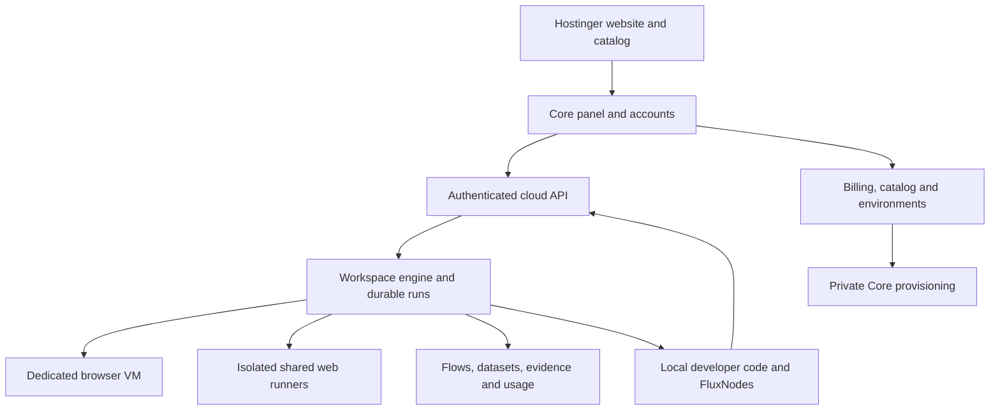

# Hosted Platform Launch Audit And Plan

Status: Active
Status detail: Audit complete; implementation queued. Separate Core hosting accepted by user; nothing deployed.
Created: 2026-11-14
Last updated: 2026-11-14
Owner: Senior supervisor agent
Scope: Hosted panel, coordinated releases, managed web cloud, local FluxNodes, marketplace and self-hosting.
Paired document: none (Core/Website inspected read-only; execution needs paired ownership records)
Related: [Hosted production](./hosted-production-plan.md), [MVP seal](./mvp-seal-plan.md)

## Current State

**Verdict:** substantial panel, IAM, SDK and managed-browser foundations exist, but FluxIQ is not yet a deploy-and-sell cloud product. Launch a safe hosted panel and authenticated dedicated web automation first, then shared compute and external marketplace publishing. Catalog work can proceed in parallel; installations wait on isolation and entitlement gates.

**User requirements (2026-11-14):** retain Hostinger landing site/Node.js CI/CD; host the Core panel independently; offer first-party apps, verified publishers and clearly labelled unverified apps/Flows through FluxIQ accounts; charge hosting markup plus a FluxIQ fee; dedicated and cheaper shared compute with customer resource control; preserve self-hosting; begin with web, later real Windows/Linux/Android. Developer FluxNodes/code can stay local while automation runs remotely. The user accepted another Core server during the audit. Nothing was purchased/deployed.

**Lead recommendations:** getfluxiq.com stays on Hostinger; app.getfluxiq.com runs Core/private product account services on persistent compute. Customer browsers use a separate worker tier, initially one isolated VM per customer. One identity/IAM system; retain existing BYOK initially. These recommendations are not additional user rules.

**Baseline:** downstream `28398c288ffbdffd150133dfb3f9355c17700ba8`; clean Core dev snapshot `04e7b1650f183868505b2e0c076e339b9bf7ccf9`. Website is an archive without Git metadata, so revision/live parity are unknown. Primary Core is dirty task t911, not dev; its pending lease changes are excluded. The IDE's t843 reset plan explicitly says Superseded and is not a prerequisite.

**Main gaps:** tenant routing, production mail, real SDK auth/API, unattended model-key custody, durable active runs/events/callback recovery, Linux/browser deployment, environment provisioning, billing/metering, remote takeover and release/restore proof. Website accounts/marketplace are absent from the inspected archive.

**Next:** phase 0 fixes contracts/provenance; phases 1-3 proceed in parallel by file. Do not expose local open-mode APIs through a proxy or sell shared execution before isolation acceptance. Reuse existing runtime work. This source/design audit ran no live automation, paid calls, panel server, DNS change or deployment. Task tooling automatically prepared Core dependencies/builds; that is not hosted acceptance.

## Evidence And Readiness

Detailed source citations: [Core](./hosted-platform-launch-plan/reports/core-audit.md), [browser](./hosted-platform-launch-plan/reports/browser-audit.md), [website](./hosted-platform-launch-plan/reports/website-audit.md). Implemented means inspected source, not production acceptance.

| Area | Existing | Remaining |
| --- | --- | --- |
| Website | Static Next export served by Node; Hostinger build documented | Signup/catalog/checkout; live source provenance |
| Panel | Dockerfile, Compose profiles, Caddy, health checks, persistent mount | Actual Linux/TLS/email/restore proof; composed web-domain/browser product |
| Accounts | IAM, platform SQLite, private provisioning, sessions, tenant manager | Auth/program routes/gateway still use primary-instance paths; C2/C3 migration |
| Email | File/none senders | Production delivery and recovery |
| SDK | Remote URL, HTTP/SSE, local callback answers | P3b server/session and public mounting; current headless API is loopback/open-mode |
| Durability | Saved Flows/tasks/effects, same-process reconnect | Active run registry/events/callback waits are in memory; restart recovery |
| Browser | Chromium launcher, enrollment, profiles, leases/cleanup | Fleet, Linux image, remote viewer, OS-level customer isolation |
| Extension | Editable URLs, managed enrollment | Hosted server profiles/sign-in, data minimization/store copy |
| Billing | Generic billing/entitlement ports | Subscription, ledger, compute lifecycle/reconciliation |
| Marketplace | Flow/library building blocks | Publisher/catalog/package/install/version/entitlement/revocation lifecycle |
| Self-hosting | Profiles/deployment assets | Same-release install/upgrade/restore/export proof |

Supervisor independently inspected Core auth/program route, email resolver, SDK session/execute-run, server open-mode guard, downstream browser launch/named-profile and Website config/workflows/docs. Exact paths are in the reports. The old no-hosted-extension-code statement is stale: enrollment exists, consumer hosted sign-in does not. W5 improvements do not close C2/C3. Core's FluxNode plan already names cloud API/pools/metering under P12 and local/cloud parity. This plan expands that direction and replaces the old same-VM landing-site recommendation; existing runtime contracts remain authoritative. Do not resume t843.

## Hosting And Ownership

Hostinger's current [Node.js limits](https://www.hostinger.com/support/hostinger-node-js-limits-for-web-and-cloud-plans/) exclude inbound WebSockets, persistent workers, Docker and extra services, with a 120-second request limit. Keep it for the website, not Core's gateway/browser fleet. Its [Git guide](https://www.hostinger.com/support/how-to-deploy-a-nodejs-website-in-hostinger/) supports website auto-deployment. Capture hPanel settings before rollout: user calls the package Cloud Starter; docs say Cloud Startup.

Accepted topology: separate Core server. Recommend a persistent Linux VM on AWS plus separate customer workers; select region/size from measurements. AWS is a candidate, not a purchase or cheapest-price claim. Keep provider integration replaceable.

Return events use client-initiated streaming and answer POST, not inbound laptop access. Debugging/provisioning/storage stay private. Customer execution must not share the control plane's security boundary.

| Owner | Responsibilities |
| --- | --- |
| Core | Identity/IAM, tenancy, SDK/protocol, durable execution, neutral host leases, datasets/lineage, panel, generic commercial ports |
| Web-extension | Browser/domain, launcher/image, web takeover, consumer/store UX, browser acceptance |
| Website | Public marketing/catalog/pricing/publisher presentation, account links |
| Product unit, initially downstream deploy/ | Pinned composition, release manifest, infrastructure/environment controller, billing/catalog adapters, operations; focused modules |
| Customer app | Local declarations/checks/transforms/business UI; optional hosted callback/app worker |

Core keeps generic container assets. Product packaging layers pinned public web capabilities, not private imports/copied runtime. Website backend code may deploy beside Core; no provisioning secret in Hostinger's static server. Create paired records before implementation.

## Product Contracts

### Local Code, Cloud Automation

Register a developer public key, keeping its private key local. Scope sessions to account/workspace/environment/actions. SDK sends serializable declarations/inputs/runtime requirements and idempotency identity; JavaScript callbacks are not uploaded. Cloud engine chooses an authorized browser, loads/learns a Flow and records typed output/evidence/usage. Local checks/transforms/person callbacks receive events and POST answers; applications can combine results with their own local data.

Persist runs/events/answers before acknowledgement and fence ownership. Resume by durable cursor, deduplicating submissions and reconciling uncertain lasting effects. If callbacks disconnect, keep recoverable waiting state and release capacity where safely resumable. A closed laptop cannot run local callbacks. Scheduled pipelines need an explicitly uploaded worker/app or a customer-operated always-on callback worker; callback-free saved Flows can run entirely hosted.

FluxIQ access keys differ from provider keys. Preserve BYOK. P3b must grant approved tenant model access after logout/restart through encrypted custody, explicit service grants, rotation/revocation/audit; never borrow another person's latest unlock or silently introduce a platform key.

### Accounts And Website

One identity system; distinguish account/workspace, billing customer, environment, publisher and installation. Put signup/login/account/billing/install on app.getfluxiq.com, with allowlisted deep links from public pages. Adapt the signup stand-in into a co-located service calling private provisioning; Hostinger need not join its private network.

Use secure host-only app cookies, CSRF and exact origins. Publisher UIs use a separate untrusted-app origin and scoped API consent, never app cookies. Public catalog reads need no secret. Real verification/recovery email, revocation/export/deletion and updated privacy copy precede public signup.

### Compute And Control

| Offer | Control | Commercial boundary |
| --- | --- | --- |
| Self-hosted | Same engine/SDK/web-host on own infrastructure | No managed-cloud subscription for ordinary local execution; verify licenses |
| Dedicated | Customer VM, CPU/RAM/storage/concurrency, start/stop/resize/export | Infrastructure plus markup and FluxIQ fee; no physical-host exclusivity promise |
| Shared | Isolated allocation, smaller reservations, documented queue/concurrency | Allocated compute/storage/transfer; no root on shared host |
| Customer cloud, later | Managed install in customer's account | Separate IAM/onboarding/support scope |

Expose reservations and measured use. Decide optional dedicated guest-admin access; if offered, isolate platform credentials/metadata and define support/recovery after customer changes. VM control does not imply AWS-account ownership. Avoid unlimited sustained-CPU claims on burstable instances: [AWS credit behavior](https://docs.aws.amazon.com/AWSEC2/latest/UserGuide/burstable-credits-baseline-concepts.html).

Dedicated comes first for simpler isolation; shared remains planned. Shared requires OS isolation, protected networks/metadata, tenant volumes/secrets, resource control and cleanup/escape tests. Profiles alone are insufficient. AWS warns ordinary [ECS/EC2 containers lack task isolation](https://docs.aws.amazon.com/AmazonECS/latest/developerguide/task-iam-roles.html). Evaluate VM/microVM or isolated managed tasks against real browser compatibility and cost.

### Marketplace

Separate Flow/templates, FluxNode/pipeline packages with callback-location requirements, and complete frontend/backend apps. Installing a Flow does not imply arbitrary app-server hosting. Show execution location, permissions and payer.

Immutable versions record publisher, digest/signature, engine/runtime compatibility, schemas, site/network/secret permissions, callback requirements, provenance/license/update policy. Exclude credentials, cookies, profiles and customer data. Install tenant-owned instances with pinned versions, separate secrets/learned state; upgrades cannot silently gain permissions.

Label FluxIQ, verified third party and unverified third party. State what verification means, not a safety guarantee. Show warnings and permission/version changes at install. Every tier needs validation, applicable malware/dependency scans, containment, reporting/takedown and revocation. Warnings are not isolation.

Start free first-party catalog, then verified submissions, then unverified publication after moderation/containment acceptance. Paid marketplace sales/payouts need separate rights/refunds/commercial policies; cloud monetization does not depend on them.

### Analytics And Consultant Demo

Core answers whether pipelines worked and data is trustworthy: freshness/health, typed rows, lineage, dedupe/changes, model calls/replay rate, compute cost/recovery. Customer interpretation belongs in the application; generated dashboards are not a prerequisite.

Use the contract-opportunity reference app: trade/region, eligibility, deadlines, mandatory visits, sources, changes/freshness. Collector code can run locally with cloud browsers while the frontend consumes scoped public results. Never expose private panel sessions. Recheck real tenders before publication; attachment examples are unverified ideas.

Demonstrate two differently structured sources with the same schema, dedupe, observed changes, evidence and actual replay calls/time/cost. Signed-in invoices wait on credential/profile isolation and takeover. Other proposed apps are follow-ups.

## Cohesive Release Strategy

A release is a tested version set, not one server/repository. Manifest: Core commit/packages/image digest; web-domain/browser-host/extension versions; Website commit/artifact; SDK/protocol compatibility; runtime bundle; migration and infrastructure revisions. Replace local sibling link assumptions with pinned packages or explicit multi-repo CI inputs, never absolute machine paths/mutable dev tips.

1. Validate/build immutable artifacts per repo; compose exact manifest and exclude secrets/runtime data.
2. Deploy staging; test TLS/WebSocket/SSE, email/signup, tenant isolation, remote SDK, browser recovery and restore.
3. Apply additive migrations, deploy compatible backend first, drain through durable ownership and verify synthetic tenant journey.
4. Promote tested Website commit through approved Hostinger branch. Hostinger auto-deploy is independent of GitHub checks: gate its watched branch or configure a controlled release branch so failed CI cannot deploy anyway.
5. Verify non-sensitive live version markers and record deployed manifest. Ordered compatible promotion is not an atomic multi-host transaction; old site must still work if frontend promotion fails.
6. Roll back compatible images/site together. Expand/contract migrations; irreversible changes need proven restore, not assumed code rollback.

Website has Hostinger main builds and GitHub-generated static deploy branch. Confirm actual active path and remove redundant triggers for this deployment. Its own main-push approval rule remains binding until changed; this plan does not bypass it or publish anything.

Initially one authoritative workspace state owner with persistent disk. Multiple replicas over shared SQLite files are not horizontal scaling. Later fleet maps/fences workspace owners and restores/reassigns deliberately; external database adoption is separate measured work. Back up platform/workspace state, Flows/datasets, billing and encrypted secrets; prove decryptability and tenant ownership on restore. Profiles need consistent encrypted snapshots, retention/deletion.

## Implementation Phases

Planning only. Use written file-disjoint briefs, sequencing shared auth/lease changes. No calendar launch date is justified before deployment/security spikes. Existing full-suite frequency limits remain binding.

### Phase 0 — Contracts And Provenance

- Capture Website source/revision, actual Hostinger branch/build/entry, DNS/TLS/plan; reconcile P3b and t911 with dev. Keep t843 superseded.
- Write paired plans/ADRs: identity/workspace/environment IDs, key custody, durable run/answer protocol, host leases, artifact types and release manifest.
- Define dedicated/shared promises, billing units, region/retention/control surfaces. Default to existing BYOK.
- Exit: one owner/compatibility policy/acceptance test per seam and identifiable release inputs.

### Phase 1 — Safe Panel And Accounts

- Core owners: workspaces, auth/app-route-IAM, API adapters, gateway tenancy, provisioning/email. Coordinate P3b shared files.
- Finish C2/C3; mechanically reject primary-instance shortcuts in service paths. Cover HTTP/WebSocket/streams/downloads/datasets/keys/background work.
- Production mail, signup/verification/recovery/revocation, welcome project, export/deletion; private co-located signup service.
- Exit: two fresh accounts complete lifecycle over TLS; adversarial forged-ID/reconnect/eviction/restart tests prove isolation; local/self-hosted parity passes.

### Phase 2 — Cloud SDK And Durable Runs

- Core owners: SDK session, server FluxNode API, P3b keys/custody, runtime run/events/callbacks and lease consumers; coordinate t911.
- Implement proof/session verification, audience/replay protection, enrollment/rotation/revocation, IAM and production API mounting. Preserve local open-mode safeguards.
- Persist runs/events/answers/waits/resume; fence ownership; survive lost responses, duplicate POSTs, callbacks/engine/worker disconnection without duplicate lasting acts.
- Unattended BYOK and safe capacity release while waiting. Do not add arbitrary timeout failure instead of result, budget exhaustion or user Stop.
- Exit: another machine executes local FluxNode callbacks against real authenticated cloud engine and gets typed outputs. Four attempts prove predecessor-Flow continuation/calls. Restart/duplicate/revocation proof uses actual service, not fake SDK server.

### Phase 3 — Linux Product And Dedicated Runner

- Downstream: browser-host, product/domain packaging and deploy composition. Core container/TLS/discovery changes use separate briefs.
- Pin Chromium/extension/domain, Linux libraries, sandbox/non-root execution, persistent profiles/cleanup; build on clean Linux CI.
- Scoped remote enrollment/heartbeat/health/lease routing. Idempotent VM create/status/start/stop/resize/delete with partial-failure reconciliation.
- Authenticated remote viewing/takeover for login/MFA/person-needed, no public debugging. Protect private networks/metadata; prove profile/secret ownership through recovery.
- IaC, staging/production TLS, mail, secret delivery, readiness/monitoring, encrypted backup/restore; alert stalled work, cleanup, disk, lease, mail and cost failures.
- Exit: fresh Linux deploy, actual gateway/SSE/enrollment, login persistence/takeover, restart, failed-allocation cleanup and decryptable restore with disposable tenants. Health endpoint alone is insufficient.

### Phase 4 — Paid Dedicated Web Beta

- Product owns environment controller, billing/usage ledger and account UI; Website consumes API.
- Meter allocated/active compute, idle reservations, stopped storage/IP, transfer/concurrency/model use separately. Unique usage IDs and tenant attribution; reconcile provider totals.
- Checkout/subscriptions, verified idempotent webhooks, failure/grace/suspension, cancel/export/retention/teardown. No duplicate VM/charge on retry; active work settles safely under stated policy.
- Exit: test-mode purchase through provisioning/run/usage/invoice/cancel/delete, including failure/reconciliation; measured margin before prices. Same artifacts self-hostable.

### Phase 5 — First-Party Catalog And App

- Website/product: listings/install/publisher registry. Core: missing generic portable packages/import/export/permission seams.
- Immutable packages, tenant install/secrets, runtime/cost explanation, consented upgrades/rollback; static-friendly browsing.
- Ship consultant reference app/source/safe lineage; prove nonempty exact data, freshness, dedupe and changes.
- Exit: new account discovers/installs/runs cloud app; local developer uses cloud browsers; self-hosted user imports same package; no private data in exports.

### Phase 6 — Shared Compute And External Publishers

- Parallel isolation and publisher lanes after frozen artifact/permission contracts.
- Reservations/fair scheduling/recycling/egress/tenant volumes/profiles/usage. Test malicious artifacts, noisy neighbours and metadata/private-network access.
- Verification/scanning/review/provenance, unverified warning/permission diffs, moderation/reporting, vulnerable versions/emergency revoke; no silent version replacement.
- Exit: measured shared savings and no residual tenant state. Verified then unverified publication after containment/moderation proof; paid payouts separately gated.

### Phase 7 — Real OS Environments And Customer Cloud

- Real Linux/Windows desktop/Android providers through neutral host contracts in domain-owned repos. Linux-hosted web browsers are not a general Linux automation client.
- Prove image lifecycle, interaction, patching/licensing/persistence/isolation/cost; simulators do not count as production acceptance.
- Add customer-cloud installations and hosted callback/app workers without removing local SDK/self-hosting.

### Parallelism And Critical Path

After phase 0: panel/tenancy, SDK/durability and Linux packaging run in parallel by file; shared identity/lease integration remains ordered. Catalog design/navigation/reference app can advance against pinned contracts. Paid beta and customer installations require phases 1-3. Critical path is tenant routing, SDK auth, durable recovery and real browser deployment, not landing-page redesign.

## Economics And Acceptance

Invoice model: infrastructure allocation + disclosed hosting markup + FluxIQ management fee + disclosed variable services. Internal cost includes idle capacity, storage/backups, transfer/IP, mail/logs, payment/support, failed allocations and control-plane share. With BYOK, provider bills models separately. Show remaining storage/IP costs after stop and final deletion path.

Shared pricing may use allocated vCPU/memory time or reserved concurrency; define idle browser reservations. Dedicated pays for reserved environment. Measure idle, one/many browsers, exploration/replay/takeover/recovery at low/typical/high occupancy. [Lightsail pricing](https://aws.amazon.com/lightsail/pricing/) is a comparison source, not a best-price recommendation. No retail/provider quote or margin promise established here. Reconcile infrastructure to eliminate orphaned paid resources; commercial controls cannot conceal runtime defects.

New code needs owner-local tests/typechecks and structural gates, then composed acceptance. Browser checks use the ten allowed realistic scenarios: exploration plus three continuations, exact output/Flow/calls/time. Provider-free first; paid Claude checks separately announced/supervised under existing allowance. None launched here.

Production acceptance: install/upgrade/rollback; signup/recovery/revoke; tenant/network isolation; local callbacks/disconnects; engine/worker crashes around lasting acts; reuse; persistent login/takeover; billing/reconciliation; cancel/export/delete; decryptable restore; package permission/revocation; self-hosted parity. Record exact manifest/environment/redacted evidence. CI fails missing authorization, incompatible/unpinned artifacts and required acceptance failures.

Before payments, assign merchant/support owner, service/privacy/retention terms, acceptable-use/abuse response, publisher terms and applicable tax/OS license review. These are rollout requirements, not legal findings. Provide security contact, incident response, access audit/export/restore runbooks. Exclude private pages/cookies/tokens/provider keys from logs.

## Worker Briefs

Briefs were written before dispatch; compact scope preserved here. Each owned only its report; no source/shared-doc/git edits, builds, servers or paid calls.

- core-audit: gpt-6.1-sol medium discovery; Core instructions/hosted/FluxNode Current State, committed source and separate t843 status. Owned `hosted-platform-launch-plan/reports/core-audit.md`; exact source evidence, merged/WIP distinction, remote protocol and gaps required.
- browser-audit: gpt-6-luna high discovery; hosted/MVP Current State, layout, connection/browser-host/product/signup/deployment. Owned `hosted-platform-launch-plan/reports/browser-audit.md`; isolation/persistence/takeover/Linux/connection evidence required.
- website-audit: gpt-6-luna high discovery; Website instructions/config/routes/deployment workflows. Owned `hosted-platform-launch-plan/reports/website-audit.md`; distinguish archive evidence and user live statement; record Git provenance limit.

## Work Ledger

### 2026-11-14 — Source audit and product/deployment plan
- Agent: Senior supervisor with three discovery workers.
- Changed: Plan, evidence reports and generated working index.
- Why: Reconcile foundations with cloud, local FluxNodes, marketplace and Hostinger limits.
- Validation: `git rev-parse HEAD` in Core snapshot -> `04e7b1650f183868505b2e0c076e339b9bf7ccf9`; targeted source reads confirmed local-only API, file-only mail, primary-instance routes and browser lifecycle. Documentation gates follow.
- Outcome: Accepted as audit/design, not runtime/deployment acceptance.
- Follow-up: Phase 0/paired briefs when execution requested; preserve active t911/unrelated changes.

### 2026-11-14 — Documentation validation
- Agent: Senior supervisor.
- Changed: Generated working index includes this plan and its report links.
- Validation: `node scripts/structure-audit.mjs --rule working-docs --rule docs-links` -> `passed (0 warning(s), 2 baselined)`; `node scripts/structure-audit.mjs` -> `passed (250 warning(s), 552 baselined)`; `git diff --check` -> exit 0, no output.
- Outcome: Accepted; warnings are existing structural advisories, not fresh runtime validation.
- Follow-up: Commit/push the audit task; full code suites and live hosting checks not required for this documentation-only unit.

## Open Questions

Decide at named execution gate; these do not block completion of this audit. Defaults are recommendations, not claims of user approval.

1. Operator, phase 0: actual Hostinger branch/source/settings, cloud account/region/measured size. Separate Core hosting already accepted.
2. User/product, paid beta: dedicated guest-admin access, fees/markup/currency/support, commercial/self-hosted license and BYOK versus future bundled models. Default resource control/BYOK, no physical-host exclusivity claim.
3. Lead/security, phases 1-3: P3b custody, C2/C3 closure, t911 integration, durable callback semantics and worker isolation choice.
4. Operator, phases 3-4: email/billing accounts, recovery/retention targets, backup region, legal operator/policies.
5. Publisher owner, phases 5-6: verification/artifact/app-hosting policy, moderation capacity and early paid sales/payouts. Default free first-party, then verified, then labelled unverified publication.
